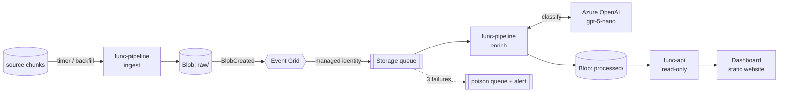

# ReviewLens: Serverless Data & AI Pipeline on Azure

Ingests Thai restaurant reviews every day, classifies them with an LLM, and serves the analytics on a dashboard. Event-driven, fully serverless, provisioned with Terraform and deployed through GitHub Actions with OIDC: no keys or connection strings anywhere.

[](https://github.com/BobThanakorn/reviewlens-azure-serverless/actions/workflows/ci.yml)



## Skills demonstrated

| Skill | Where to look |
|---|---|
| Infrastructure as Code (Terraform, modules, remote state) | [`terraform/modules`](terraform/modules), [`terraform/envs/dev`](terraform/envs/dev), [`terraform/bootstrap`](terraform/bootstrap) |
| Serverless, event-driven design | [`src/pipeline`](src/pipeline), [`modules/eventing`](terraform/modules/eventing), [ADR 001](docs/adr/001-serverless.md), [ADR 002](docs/adr/002-storage-queue-buffer.md) |
| Identity and least privilege (managed identities, no keys) | [`envs/dev/main.tf`](terraform/envs/dev/main.tf), [ADR 006](docs/adr/006-split-function-apps-by-privilege.md), [ADR 007](docs/adr/007-user-assigned-identity-for-functions.md), [architecture](docs/architecture.md#identities-and-access) |
| CI/CD with GitHub Actions and OIDC | [`.github/workflows`](.github/workflows), [ADR 004](docs/adr/004-github-oidc-managed-identity.md), [`docs/github-setup.md`](docs/github-setup.md) |
| LLM integration (validation, retries, cost control) | [`src/common/classifier.py`](src/common/classifier.py), [`src/pipeline/enrich`](src/pipeline/enrich), [ADR 000](docs/adr/000-ai-provider.md) |
| Monitoring and alerting | [`modules/monitoring`](terraform/modules/monitoring) |
| Testing and quality gates | [`tests`](tests) (184 tests, 95% coverage), ruff, tflint, checkov |
| Operations: real incidents and fixes | [`docs/runbook.md`](docs/runbook.md) (16 incidents from this build) |
| Evaluation of an AI component | [`docs/evaluation.md`](docs/evaluation.md), [`scripts/evaluate.py`](scripts/evaluate.py) |

## Key results

- **500** reviews ingested and classified over a 10-day backfill. The one message poisoned during runbook incident 15 was reprocessed after the fix, so no review was lost.
- **77.4%** agreement with star ratings (387/500). 88% of the disagreements are positive vs neutral, where the star rating itself is often the noisy side ([analysis](docs/evaluation.md#analysis)).
- **357k tokens** for the whole run (331,825 input, 25,272 output), about 50 output tokens per review with `reasoning_effort=minimal`.
- 59 Azure resources from Terraform (14 bootstrap, 45 dev), zero secrets: storage accounts have shared-key access disabled and every service authenticates with Entra ID.

## Prerequisites

- An Azure subscription where you can create resources and role assignments (built on Azure for Students).
- Azure CLI, Terraform >= 1.10, Python 3.12, Git. Commands below are PowerShell.
- A GitHub repository for the CI/CD part.

## Quickstart

```powershell
python scripts/tasks.py init            # .venv, dependencies, terraform init -backend=false
python scripts/tasks.py test            # pytest with the 80% coverage gate
python scripts/tasks.py dev             # dashboard on mock data, no Azure needed

az login
# 1. bootstrap (state account, dev resource group, GitHub OIDC identities)
copy terraform\bootstrap\terraform.tfvars.example terraform\bootstrap\terraform.tfvars   # edit
terraform -chdir=terraform/bootstrap init; terraform -chdir=terraform/bootstrap apply
# 2. dev environment
copy terraform\envs\dev\terraform.tfvars.example terraform\envs\dev\terraform.tfvars     # edit
copy terraform\envs\dev\backend.hcl.example terraform\envs\dev\backend.hcl               # from bootstrap outputs
terraform -chdir=terraform/envs/dev init "-backend-config=backend.hcl"
python scripts/tasks.py deploy          # terraform apply, then publish both Function Apps
$env:REVIEWLENS_DATA_ACCOUNT_URL = terraform -chdir=terraform/envs/dev output -raw data_blob_url
python scripts/tasks.py bootstrap-data
python scripts/tasks.py backfill --days 1   # canary first
python scripts/tasks.py smoke-test
python scripts/tasks.py evaluate
```

A new subscription may need resource providers registered first (`Microsoft.Web`, `Microsoft.EventGrid`, `Microsoft.OperationalInsights`, `microsoft.insights`, `Microsoft.AlertsManagement`), see runbook incident 11. For GitHub Actions, follow [`docs/github-setup.md`](docs/github-setup.md).

## How it works

1. **Ingest:** a timer at 01:00 UTC (08:00 Bangkok) copies the next 50-review chunk into `raw/dt=<date>/`. `POST /api/ops/backfill` does the same for N days. The cursor is a state blob updated with an ETag condition, so concurrent runs cannot double-ingest.
2. **Event:** Event Grid turns each new raw blob into a queue message, delivered with the topic's managed identity.
3. **Enrich:** the queue trigger classifies every review (sentiment, topic, Thai one-line summary) with Azure OpenAI, validates the JSON, re-asks once on invalid output, retries 429s with backoff, and writes `processed/`. Already-processed chunks are skipped, so redelivery is safe; three failures send the message to the poison queue and fire an alert.
4. **Serve:** a separate, read-only Function App exposes `stats/daily`, `stats/topics`, `stats/accuracy` and `reviews`; the static dashboard calls it.

More detail: [`docs/architecture.md`](docs/architecture.md) and the ADRs in [`docs/adr`](docs/adr).

## Cost and teardown

Nothing runs when idle: Flex Consumption scales to zero and the model is billed per token. Drivers, real token usage and official pricing links are in [`docs/cost.md`](docs/cost.md) (no invented prices).

Teardown is deliberately manual: `python scripts/tasks.py destroy` only prints the steps. Run `terraform -chdir=terraform/envs/dev destroy` yourself, or the `destroy` workflow with `confirm=destroy`; destroy `terraform/bootstrap` last.

## Dataset credit and license

Reviews come from the [Wongnai Reviews dataset](https://huggingface.co/datasets/Wongnai/wongnai_reviews) (`Wongnai/wongnai_reviews`), licensed under **LGPL-3.0**. This repository does not redistribute the dataset, apart from a 20-row sample in `sample-data/sample.jsonl` used by the tests. The project code is MIT licensed (see `LICENSE`).

## Production next steps

- **Multiple environments** (dev/test/prod) with separate state, subscriptions and approval gates.
- **Key Vault and customer-managed keys** for storage and the AI account.
- **PII masking before the LLM** (names, phone numbers in review text).
- **Durable Functions** for large files instead of one queue message per chunk.
- **Entra auth on the API, behind Front Door with WAF**, instead of an anonymous read API.
- **SQL or Fabric analytics layer** on top of `processed/` for ad-hoc queries.
