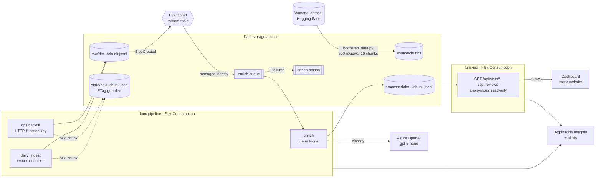

# Architecture

ReviewLens is an event-driven pipeline on Azure serverless services. Everything is provisioned by Terraform (`terraform/`) and authenticates with Entra ID: no storage keys, connection strings or API keys are stored anywhere. Detailed design: `docs/spec/design.md`; decisions: `docs/adr/`.

## Data flow

1. **Ingest.** `daily_ingest` (or `ops/backfill` for N days) copies the next source chunk to `raw/dt=<date>/`. The cursor lives in `state/next_chunk.json` and is updated with an ETag condition, so two concurrent runs cannot ingest the same chunk.
2. **Event.** Storage raises `BlobCreated`; the Event Grid subscription (filter: `raw/`, `.jsonl`) writes the event, base64-encoded, to the `enrich` queue using the topic's managed identity (ADR 009).
3. **Enrich.** One message = one chunk of 50 reviews. `enrich` classifies each review (sentiment, topic, Thai summary), validates the JSON, re-asks once on invalid output, backs off on HTTP 429 and writes `processed/` with token counts. It skips chunks that already have output, so redelivery is safe. After three failures the message goes to `enrich-poison`, which raises an alert.
4. **Serve.** `func-api` reads only `processed/` and returns aggregates (`stats/daily`, `stats/topics`, `stats/accuracy`) and filtered reviews. The dashboard is a static page that calls the API.

## Identities and access

| Principal | Access | Why |
|---|---|---|
| func-pipeline identity | Blob Data Contributor + Queue Data Contributor on the data account; OpenAI User on the AI account | ingest, read queue, write output, call the model |
| func-api identity | Blob Data Reader on `processed` only | the public API cannot read raw data or write anything (ADR 006) |
| each app identity | Blob Data Owner + Queue Data Contributor on its own host account | Functions runtime storage, shared keys disabled |
| Event Grid topic identity | Queue Data Message Sender on the data account | deliver events (ADR 009) |
| GitHub `plan` identity | Reader on the dev RG, Blob Data Reader on the state container | pull-request plans (OIDC subject `pull_request`) |
| GitHub `apply` identity | Contributor + User Access Administrator on the dev RG, Blob Data Contributor on state | deploy from `main` only (ADR 004) |

## Environments and state

- `terraform/bootstrap`: run once locally; creates the state account, the dev resource group and the two GitHub OIDC identities. Local state, git-ignored.
- `terraform/envs/dev`: everything else; remote state in the bootstrap account (Entra auth, versioning, soft delete).
- CI/CD: `ci.yml` (lint, tests, Terraform checks, plan on PRs), `deploy.yml` (apply, publish code, smoke test on `main`), `destroy.yml` (manual, requires typing `destroy`).

## Known platform quirks handled in code

- azurerm injects an empty-key `AzureWebJobsStorage` into Flex Consumption apps; `deploy_functions.py` removes it (runbook incident 13).
- `admin/` routes are reserved by the Functions host (incident 14).
- Event Grid writes base64 queue messages (incident 15).
