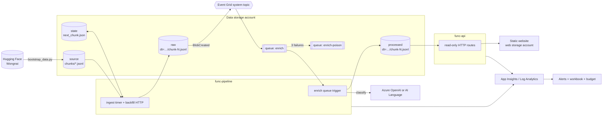

# Design

Status: DRAFT, awaiting approval. Source: `docs/PROJECT_BRIEF.md`. Items marked **VERIFY** depend on Phase 0 results or on current docs and may change (each change becomes an ADR).

## 1. Architecture



Hosting: two Python v2 Function Apps on **Flex Consumption** (max 2 instances each) if available in the chosen region (**VERIFY**); otherwise the current recommended serverless plan, recorded in an ADR.

## 2. Data flow

1. `bootstrap_data.py` (local): sample 500 reviews → `source/chunks/000001..000010.jsonl`.
2. **Ingest** (timer 01:00 UTC = 08:00 Bangkok, or admin backfill): read `state/next_chunk.json` + ETag → copy chunk to `raw/dt=D/chunk-NNNNNN.jsonl` with `ingested_at` → write the new state with `If-Match`.
3. Blob creation raises an Event Grid `BlobCreated` event → system topic → event subscription → `enrich` queue.
4. **Enrich** reads the event (`data.url`), derives the blob path, skips if `processed/...` exists, else classifies each review and writes the processed blob in one upload (so existence means complete).
5. **API** lists `processed/dt=*` for the date range, reads blobs, de-duplicates by `review_id`, aggregates in Python.
6. **Web** calls the API using `config.js`.

Idempotency: deterministic blob names, atomic single-blob writes, ETag state. Crash window: if ingest dies after the raw write but before the state update, the next run re-ingests the same chunk number (possibly under a different `dt`); enrich runs again and the API de-duplicates by `review_id`.

## 3. Storage layout

| Account | Container / queue | Content |
|---|---|---|
| data | `source` | `chunks/NNNNNN.jsonl` (input) |
| data | `raw` | `dt=YYYY-MM-DD/chunk-NNNNNN.jsonl` |
| data | `processed` | `dt=YYYY-MM-DD/chunk-NNNNNN.jsonl` |
| data | `state` | `next_chunk.json` |
| data | queue `enrich`, `enrich-poison` | Event Grid events |
| func deployment | container per app | Flex Consumption package storage (**VERIFY**: may reuse data account or use its own) |
| web | `$web` | `index.html`, `app.js`, `config.js` |
| tfstate | `tfstate` | Terraform state (bootstrap) |

Names get a random suffix (3 to 24 chars, lowercase). Prefix `rl-dev` for non-storage resources.

## 4. Schemas

**source line:** `{"review_id": 12, "review_text": "...", "stars": 4}`

**raw line:** source fields + `"ingested_at": "2026-11-25T01:00:03Z"`

**processed line:** `review_id, review_text, stars, sentiment, topic, summary, status, provider, model, input_tokens, output_tokens, processed_at`
- `sentiment` ∈ positive | neutral | negative | unknown
- `topic` ∈ food | service | price | atmosphere | cleanliness | other | unknown
- `status` ∈ ok | invalid_output | error
- `summary`: Thai, <= 120 chars

**state:** `{"next_chunk": 3, "updated_at": "..."}` (ETag-guarded)

**backfill request:** `{"backfill_days": 3}` → `{"ingested": [{"chunk": 1, "dt": "2026-11-23"}, ...], "remaining": 7}`

**queue message:** raw Event Grid schema event. Blob path comes from `subject` (`/blobServices/default/containers/raw/blobs/dt=.../chunk-000001.jsonl`). `host.json` sets `queues.messageEncoding = "none"` because Event Grid writes plain JSON, not base64.

**API responses** (all `application/json`):
- `/api/stats/daily?days=14` → `{"days":14,"series":[{"date":"...","total":50,"positive":..,"neutral":..,"negative":..,"unknown":..}]}`
- `/api/stats/topics` → `{"topics":[{"topic":"food","count":..,"negative":..}]}`
- `/api/stats/accuracy` → `{"sample_size":..,"accuracy":0.0-1.0,"labels":[...],"confusion_matrix":{"<truth>":{"<predicted>":n}}}` (rows = truth from stars, columns = predicted, includes `unknown`)
- `/api/reviews?sentiment=negative&limit=20` → `{"count":..,"reviews":[{review_id, review_text, stars, sentiment, topic, summary, date}]}` (newest first)
- Errors: `{"error": "<short message>"}` with 400/404/500, no stack traces.

## 5. Classifier

```
src/common/classifier.py
  class Classification(sentiment, topic, summary, input_tokens, output_tokens, model, provider)
  class Classifier(Protocol): classify(text: str) -> Classification
  class OpenAIClassifier   # chat completion, JSON output, validation, one re-ask, 429 backoff (<=5, jitter)
  class LanguageClassifier # AI Language sentiment + Thai keyword topic table + text[:120]
  def get_classifier(settings) -> Classifier   # reads CLASSIFIER_PROVIDER
```
- Prompt in `src/pipeline/enrich/prompt.py`: system rules + 3 hand-written few-shot examples (not from the dataset).
- Auth is `DefaultAzureCredential` (managed identity). No keys.
- Tests inject fake SDK clients; no network.
- Language provider: the Azure AI Language sentiment API labels `mixed`; mapped to `neutral`. Thai support is **VERIFY** in current docs.

## 6. Code layout

```
src/common/    classifier.py, storage.py (blob/queue helpers, ETag), config.py, logging.py, models.py
src/pipeline/  function_app.py, ingest/, enrich/ (handler.py, prompt.py)
src/api/       function_app.py, aggregate.py, validation.py
```
Business logic lives in plain modules; `function_app.py` stays a thin binding layer so tests don't need the Functions host.

## 7. RBAC matrix (all scoped to the exact resource)

| Principal | Role | Scope |
|---|---|---|
| func-pipeline MI | Storage Blob Data Contributor | data account |
| func-pipeline MI | Storage Queue Data Contributor | data account |
| func-pipeline MI | Cognitive Services OpenAI User (if `openai`) / Cognitive Services User (if `language`) | the AI account |
| func-pipeline MI | Storage Blob Data Owner + Queue Data Contributor | its own host/deployment storage account (no business data) |
| func-api MI | Storage Blob Data Reader | `processed` container only |
| func-api MI | Storage Blob Data Owner + Queue Data Contributor | its own host/deployment storage account (no business data) |
| Event Grid system topic MI | Storage Queue Data Message Sender | data storage account (managed-identity delivery; ADR 009) |
| Deploying user (var) | Storage Blob Data Contributor | `source` container (for `bootstrap_data.py`, since Owner has no data actions) |
| GitHub apply MI | Contributor + User Access Administrator | app RG only |
| GitHub apply MI | Storage Blob Data Contributor | state container; web `$web` for upload |
| GitHub plan MI | Reader | app RG |
| GitHub plan MI | Storage Blob Data Reader | state container |

**Hardening:** restrict the apply identity's User Access Administrator with an ABAC condition limiting assignable roles to the list above (ADR 004).

## 8. Error handling

| Failure | Behaviour |
|---|---|
| Classifier 429 | Exponential backoff + jitter, max 5 attempts, then the review is `status=error`; chunk still written |
| Classifier invalid JSON | Re-ask once, then `unknown` + `invalid_output` |
| Blob read/write failure, unexpected exception | Function raises → retried by the queue → poison queue after 3 dequeues → alert |
| ETag mismatch (412) in ingest | Log warning, exit without ingesting |
| No chunks left | Log info, exit 0 |
| Event for a non-`.jsonl` or non-`raw` blob | Ignored (also filtered at Event Grid) |
| Redelivered event, processed blob exists | Skip (no AI cost) |
| API bad parameter | HTTP 400 JSON error |
| API unexpected error | HTTP 500 generic message; details only in App Insights |

Logs: JSON lines with `event`, `chunk`, `reviews`, `failures`, `latency_ms`, `input_tokens`, `output_tokens`, `provider`.

## 9. Terraform

```
terraform/bootstrap/        local state; RGs, state SA + container (versioned), 2 UAMIs + federated credentials, role assignments
terraform/envs/dev/         main.tf, backend.tf, variables.tf, outputs.tf, terraform.tfvars.example
terraform/modules/          storage, functions, eventing, monitoring, web (+ ai if openai/language account is created)
```
- Providers: azurerm pinned to the latest stable at implementation time; azapi only if needed (candidates: Flex Consumption details, static website with shared key disabled).
- Variables: `location`, `alert_email`, `monthly_budget_usd`, `github_repo`, `classifier_provider`, `name_prefix`.
- Resource provider registration is subscription-scope and outside the apply identity's RG scope, so it is done once by the user (listed in the Phase 7 checklist).
- State backend: `use_azuread_auth = true`.

## 10. CI/CD

- `ci.yml` (pull_request, same-repo PRs only): ruff, pytest+coverage, `terraform fmt -check`, `validate`, tflint, checkov, `plan -lock=false` with the plan identity, PR comment.
- `deploy.yml` (push main): checks → `apply` (apply identity) → `deploy_functions.py` → upload web → `smoke_test.py`.
- `destroy.yml` (workflow_dispatch, input `confirm == "destroy"`).
- Permissions: `id-token: write`, `contents: read`, `pull-requests: write` (plan comment only).
- Actions pinned by version tag (SHA pinning noted as a next step).

## 11. Decisions that differ from, or refine, the brief (to record as ADRs)

| # | Brief says | Proposal | Reason |
|---|---|---|---|
| a | Event Grid "subject prefix raw/" | `subject_begins_with = /blobServices/default/containers/raw/` | Blob event subjects include the container path |
| b | Plan identity: "read on state" | Use `terraform plan -lock=false` with Reader + Blob Data Reader | The azurerm backend takes a blob lease to lock, which needs write access; avoid giving PR runs write on state |
| c | Timer 08:00 Bangkok | UTC cron `0 0 1 * * *` | Flex Consumption does not support `WEBSITE_TIME_ZONE` (**VERIFY**) |
| d | Static site account | Shared keys stay **disabled** here too; static website set up with Entra auth (`storage_use_azuread`), anonymous read allowed on this account only | Implemented that way (ADR 008). **Unverified until first deploy**; fallback is enabling shared-key access on the web account only |
| g | One apps' identity type unspecified | User-assigned identity per Function App | Flex needs roles before the app exists (ADR 007) |
| h | Poison alert via queue metric | KQL alert on the host's "MaxDequeueCount ... poison" trace | Storage queue metrics are account-wide, not per queue |
| e | UAA on apply identity | Add ABAC condition restricting assignable roles | Stops privilege escalation within the RG |
| f | Anonymous API | Anonymous + CORS only for the web origin | Public read-only data; ADR 005 documents trade-off |

## 12. Open items (need your input or Phase 0 results)

1. Install Azure CLI (and optionally tflint) so Phase 0 can run.
2. Region, hosting plan, and AI provider (decided by Phase 0).
3. Whether budgets exist on Azure for Students (R9.6).
4. `alert_email` and `github_repo` values (provided at deploy time, never committed).
